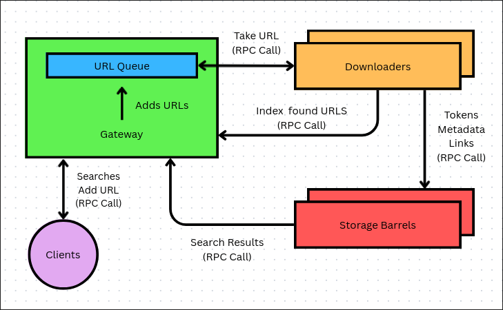

# Distributed Search Engine (Googol)
A distributed search engine where components communicate through RPC calls.



Googol works through a simple web frontend or CLI that lets the user index new URLs and perform searches.

## How it's built

### URL Queue
The URL Queue is a data structure that tracks URLs waiting to be indexed. It's implemented inside the Gateway, so both Clients and Downloaders can add URLs through the same RPC endpoint. Clients use it when submitting a URL manually, and Downloaders when they discover new links while crawling the web pages.


### Gateway
The Gateway exposes the URL Queue via two RPC methods: `putNew()`, used by both Clients and Downloaders to add a URL to be indexed, and `takeNext()`, used by the Downloaders to pull the next URL to crawl. It also serves as the entry point for the clients, `search()` returns ranked results for a set of search terms, and `getIncomingLinks()` returns pages linking to a given URL.

### Client
The Client is the program a user interacts with directly and it invokes RPC calls on the Gateway. Users can index new URLs, perform searches, look through the results with pagination and look up which pages link to a given result.

### Downloaders
Downloaders handle web crawling. Each Downloader takes a new URL from the Queue using `takeNext()`, downloads, parses and tokenizes its text, keeping only words with 3 or more characters. Each word is sent to every Storage Barrel via `addToIndex()` adding it to the inverted index alongside the URL. Title and text snippet are then sent separately via `addPageMeta()`. New URLs found are sent back to the Gateway to be queued for crawling, up to a maximum depth. Each link is also sent to the Storage Barrels with `addLinkTracking()` which saves it to a link dictionary that keeps track of incoming links between pages.

### Storage Barrels
Barrels act as the system's storage and handle search requests from the Gateway. They receive data from the Downloaders and index it into their data structures. Each Barrel saves its data to disk using `pickle`, avoiding data loss if it goes down. When a restart occurs, each Barrel tries to reload its own files.
Barrels expose three RPC methods used by the Downloaders and two for the Gateway, as mentioned in each of these components descriptions.
When the Gateway calls `search()`, the Barrel returns results ranked by number of incoming links, and metadata (title and text preview) for each result. Search results are paginated server-side, the caller specifies a page and page size, and the Barrel returns only that slice along with the total result count.

## Frontend
There is an alternative to the CLI Client implemented using a FastAPI application and Jinja2 to render pages for indexing URLs, searching and viewing incoming links for a result.

### Routes
| Route     | Method     | Purpose                                 |
|-----------|------------|-----------------------------------------|
| `/`       | GET        | Home page                               |
| `/search` | GET / POST | Search page / run a search              |
| `/index`  | GET / POST | Indexing page / submit a URL            |
| `/links`  | POST       | Show pages linking to a given URL       |

### AI Overview
On the first page of a search, an AI-generated summary of the search terms is shown above the results. For this I used a local AI model, specifically `tinyllama` through Ollama's HTTP API. The summary is only generated on the first page to avoid redundant calls when paging through results.

## Installation

### With Docker (recommended)

Requires [Docker](https://docs.docker.com/get-docker/) with the Compose plugin.

```bash
git clone https://github.com/nunessdev/distributed_search_engine.git
cd distributed_search_engine
docker compose up --build
```

Then, only the first time, pull the model used for AI summaries:

```bash
docker compose exec ollama ollama pull tinyllama
```

Open `http://localhost:8080` and you're done.
This starts the Gateway, 2 Barrels, 2 Downloaders, the web frontend and Ollama.

To use a different model, pull it the same way and update the name in `routes.py`, then run `docker compose up --build` again so the change gets into the image:

```bash
docker compose exec ollama ollama pull <model_name>
```
The number of Downloaders can be changed with `replicas` in `docker-compose.yml`, or on startup with `docker compose up --scale downloader=3`.

The CLI Client isn't part of the Compose setup. To use it, publish the Gateway's port (`8183`) in `docker-compose.yml` and run `python client.py` from a local environment (see below).

### From source

Requires Python and [Ollama](https://ollama.com/) for the AI summaries.

```bash
git clone https://github.com/nunessdev/distributed_search_engine.git
cd distributed_search_engine
python3 -m venv .venv
source .venv/bin/activate
pip install -r requirements.txt
```

Generate the gRPC code from the `.proto` file.

```bash
cd protos && bash generate-gRPC-code.sh
```
Pull the model used for AI summaries, don't forget to setup ollama beforehand:

```bash
ollama pull tinyllama
# Or bring your own model, just update the name in routes.py
```
Start the components in this order (works the same whether testing on one machine or two, as long as the addresses are configured correctly):

```bash
# Storage Barrels
python storage_barrel.py <barrel_name> <port>
# for example:
# python storage_barrel.py barrel1 8184
# python storage_barrel.py barrel2 8185

# Gateway
python gateway.py

# Downloader (can be started more than once)
python downloader.py

# CLI Client
python client.py

# Web Frontend
uvicorn app.main:app --reload --port 8080
```
The Gateway's listen address (`0.0.0.0:8183`) is still hardcoded, and each Barrel's port is set through its run parameters.

## Known Limitations

- **Fixed number of replicas.** The system was built and tested with exactly 2 Storage Barrels. Their addresses are configurable, but the Gateway and the Downloaders still expect exactly two, so adding more would need some tweaks in the components code.
- **Read endpoints use POST.** `/search` and `/links` are implemented as POST routes even though they don't modify server state.

---
*Originally built as a university assignment for a Distributed Systems course.*
